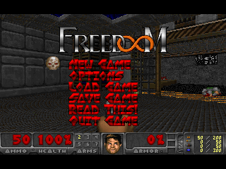
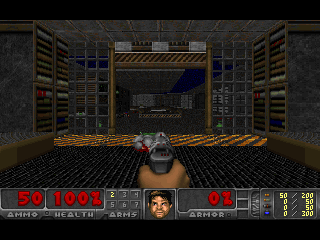

# DOOM for MPC Sample

DOOM running on the Akai MPC Sample (AC50) from an SD card. The card's autorun script stops
the sampler application, runs a statically linked DOOM binary from RAM and starts the sampler
again when DOOM exits. The package does not write to the device's internal storage. Removing
the card and power cycling returns the device to its normal state.

Tested on firmware 1.3.0.12. Other firmware versions are untested. The game is playable with
the pads, buttons and DATA knob, and quitting returns to the sampler. Sound effects are
implemented and work in the emulator but have not been confirmed on hardware. There is no
music.

## Quick start

1. Read the next section and do the backups it describes.
2. Download `doom-autorun.zip` from the
   [latest release](https://github.com/jeffwebb-to/mpc-sample-doom/releases/latest) and unzip it.
3. Copy the `autorun` folder and the `doom` folder to the root of an SD card. A fresh card is
   best.
4. Save the project that is open on the MPC Sample, then insert the card. DOOM starts a few
   seconds after the sampler has booted.
5. Hold SHIFT and press STOP to quit. The sampler comes back. Remove the card for a normal
   boot.

The zip is built by `build.sh` from this repository and contains the binary, the autorun
script, Freedoom and a plain-text copy of these instructions. Nothing needs to be compiled or
installed on a computer.

**Before you do anything else, read the next section.**

## Risk and data protection

This is an unofficial modification. It is designed so that it cannot alter the device's
firmware or internal storage, but there is no publicly verified procedure for recovering an
MPC Sample that fails to boot, so you use it at your own risk. The realistic risks are to
your data, not to the hardware, and they are easy to remove:

1. **Save the project that is open on the MPC Sample before you insert the card.** Starting
   DOOM shuts the sampler application down the same way a normal shutdown does. The
   application keeps its temporary project across that, but unsaved edits should never
   depend on it.
2. **Use a fresh SD card, or back up the card you are going to use.** Copy everything on the
   card to a computer first. The script only reads from the card's `doom` folder and never
   writes to the card, but if something goes wrong you want a copy. A spare card with only
   the DOOM files on it is the simplest option.
3. **Back up the projects and samples you keep on the device.** Use the sampler's own export
   or copy them off over USB. Do this before trying any modification, not just this one.
4. **Copying the `autorun` folder replaces any autorun folder already on the card.** If the
   card has an autorun package from something else, keep a copy of it.

Save your project. Back up your card. Back up your device. Then play.

## Controls

| Control | DOOM |
|---|---|
| PAD 1 / 2 / 3 / 4 (bottom row, PAD 1 is bottom left) | strafe left / walk back / walk forward / strafe right |
| PAD 5 / 6 / 7 / 8 | fire / use / run (hold) / next weapon |
| PAD 9 to 16 | health bar on the LEDs (green above 66 %, yellow above 33 %, otherwise red) |
| DATA knob | turn, about 9 degrees per detent. In a menu it moves the cursor |
| DATA push | Enter |
| SHIFT | Esc (opens the menu, goes back) |
| PLUS / MINUS | menu down / up |
| PLAY / STOP | Yes / No when the game asks a question |
| TAP TEMPO | automap |
| SHIFT held, then STOP | quit DOOM and return to the sampler |

Pads 1 to 8 are lit in a colour for their function: blue for movement, red for fire, green
for use, yellow for run and purple for weapon. The mapping is in `src/doomgeneric_mpc.c` in
the `pad_key` and `button_key` tables. PLUS, MINUS and the weapon keys use private key codes
(0xB0 to 0xB3) that `DG_Init` binds to the engine's `key_menu_up`, `key_menu_down`,
`key_nextweapon` and `key_prevweapon` variables so they cannot collide with movement keys.

## Installing

Do the backups in the section above first.

1. Get `doom-autorun.zip`, either from a release or by building it (see Building), and
   unzip it.
2. Copy the `autorun` folder and the `doom` folder to the root of the SD card, so the card
   contains `autorun/autorun.json`, `autorun/doom.sh`, `autorun/autorun.check`,
   `autorun/doom` and `doom/freedoom1.wad`. The script never writes to the card and never
   reads anything outside those two folders.
3. Optional. If you own DOOM, put your `doom.wad` or `doom2.wad` in the card's `doom` folder.
   The script uses the first of `doom.wad`, `doom2.wad`, `doom1.wad`, `freedoom1.wad` and
   `freedoom2.wad` that it finds. Upper-case names such as `DOOM.WAD` are accepted for the
   first three; other spellings are not.
4. Save the project that is open on the MPC Sample.
5. Insert the card. DOOM starts a few seconds after the sampler has finished booting, and it
   starts at every power-on while the card is in. Remove the card for a normal boot.
6. Quit with SHIFT then STOP, or from the game's menu. The sampler application restarts and
   reloads its project.

### If something does not go as expected

- **Nothing happens after inserting the card.** Check that `autorun` and `doom` are at the
  root of the card and not inside another folder, and that all four files are in `autorun`.
  The device only runs the script if `autorun.check` matches the other two files, so do not
  edit `autorun.json` or `doom.sh` without rebuilding (`build.sh` regenerates the check file).
- **The screen goes black and DOOM does not appear.** Wait ten seconds. If the sampler does
  not come back on its own, remove the card and power cycle. The device boots normally
  without the card.
- **DOOM freezes.** Remove the card and power cycle. The sampler application was already
  stopped cleanly before DOOM started, so this is no worse than a normal power-off.
- **The sampler does not come back after quitting.** Power cycle with the card out.
- **Sound is loud.** DOOM plays at whatever output level the sampler left. Turn the volume
  down before starting, in particular with headphones.
- **No sound.** The speaker is switched on automatically if it was off and no headphones are
  plugged in. Headphones take priority. If there is still no sound, it is not confirmed to
  work on hardware yet; see the status at the top.
- **Saved games are gone.** They are kept in RAM and are lost at power-off. This is by
  design; the program never writes to the card or the device.
- **A different firmware version.** Untested. The script checks that it is running as root
  and that `/run` is a RAM filesystem before it stops the sampler, and it restarts the
  sampler if DOOM fails to start, but a different version could behave differently in ways
  not covered here.

## Repository layout

    autorun/        autorun.json and doom.sh, the SD card script. autorun.check is generated by build.sh
    src/            doomgeneric_mpc.c  screen, pads, buttons, knob, LEDs, timing, splash
                    i_mpcsound.c      sound effects: DMX lumps, a mixer, raw ALSA PCM; music stub
                    drm_uapi.h        DRM structs and ioctl numbers declared by hand (the cross
                                      compiler image has no DRM headers)
                    SDL_mixer.h       empty header so the engine's i_sound.c compiles with FEATURE_SOUND
                    splash.h          the boot splash text as a 1-bit bitmap, generated by tools/mksplash.py
    tools/          mksplash.py, renders the splash text (needs Pillow)
    doomgeneric/    copy of https://github.com/ozkl/doomgeneric (GPL-2.0), unmodified
    wads/           Freedoom, downloaded by build.sh (not committed)
    docs/           screenshots
    build.sh        cross-compiles the binary and packages dist/doom-autorun.zip
    lab-run.sh      copies a build into the emulator and runs it
    READ ME.txt     instructions for players, included in the zip

## Building

Requirements:

- Docker, with the `mpclab-tools` image from
  [virtual-mpc-sample](https://github.com/orrpunk-art/virtual-mpc-sample). Running
  `python3 lab.py build` in that repository creates it. It is a Debian image with
  `aarch64-linux-gnu-gcc`. Any aarch64 glibc cross compiler will do if you edit the
  `docker run` line in `build.sh`.
- `curl`, `unzip`, `zip` and `python3` on the host.

Then:

    ./build.sh

This writes `build/doom` (static aarch64, about 1.4 MB), downloads Freedoom 0.13.0 into
`wads/` if it is not there, and assembles `dist/doom-autorun.zip`. The zip contains
`autorun/` with the JSON, the script, the check file and the binary, `doom/freedoom1.wad`
with its licence file, and `READ ME.txt`.

The engine is compiled unmodified. `build.sh` takes every `.c` file in
`doomgeneric/doomgeneric/` except the other platform back ends and the SDL and Allegro sound
modules, and builds them with `-DDOOMGENERIC_RESX=320 -DDOOMGENERIC_RESY=200`, so the frame
is the game's native 320x200, letterboxed on the 320x240 panel, and with `-DFEATURE_SOUND`,
which makes the engine's `i_sound.c` use the sound and music modules from `i_mpcsound.c`.
The empty `src/SDL_mixer.h` and the variables `use_libsamplerate` and `libsamplerate_scale`
defined in `i_mpcsound.c` are what `i_sound.c` needs to compile without SDL. The warnings
printed during the build come from the engine.

`autorun.check` is the SHA-256 of `autorun.json`, then `doom.sh`, then the salt
`f7bed1c9-7e90-4731-9194-c996666b4331`, written as hex. The firmware refuses to run the
script if it does not match.

## How it works

The MPC Sample is a Rockchip RK3566 running a Yocto Linux with a 6.12 PREEMPT_RT kernel,
systemd, BusyBox and glibc. The sampler is a single program, `/usr/bin/MPC Sample`, run as
`ac50.service`. The stock firmware runs `autorun/<script>` from an inserted SD card as root
at every power-on if `autorun.json` names it and `autorun.check` matches. With
`askQuestion` set to false in the JSON it runs without a prompt.

**The script** (`autorun/doom.sh`) checks that it is root and that `/run` is a tmpfs, picks
the WAD from the card's `doom` folder, copies the binary to `/run/doom` (the card is mounted
`noexec`, so it cannot be run in place) and exits if a copy of DOOM is already running. It
then stops `ac50.service` with `systemctl stop`, which lets the sampler shut down the way it
does at power-off, and runs DOOM with the WAD read directly from the card. A `trap` starts
`ac50.service` again when DOOM exits, whether it quit normally, crashed or was killed. Its
log is `/run/doom.log`.

**Screen.** The program opens `/dev/dri/card0` and takes DRM master. This fails with EBUSY
if another process holds it, for example the sampler or an earlier copy of DOOM. It selects
the connector's 320x240 mode, creates one XRGB8888 dumb buffer, registers it as a framebuffer
and sets it on the CRTC. The game thread copies each new frame into a buffer in RAM. A
separate flush thread copies that into the dumb buffer and issues `DIRTYFB` for the 320x200
game rectangle. The panel is an SPI display driven by mipi-dbi, so it only updates on
`DIRTYFB`, and a full frame takes about 50 ms on the hardware, which is why the game thread
never flushes itself. If a new frame arrives while a flush is in progress it replaces the
one that is waiting, so there is never more than one frame of lag. Frames identical to the
previous one are skipped. The letterbox bars are flushed once at startup.

**Splash.** As soon as the program owns the panel it draws a title card and keeps it up for
at least 2.5 seconds, which covers the time the engine spends loading the WAD. The text is
a 1-bit bitmap in `src/splash.h`. To change it, edit the lines at the top of
`tools/mksplash.py` and run it. It uses Pillow's built-in font, so the output does not
depend on the fonts installed on the machine. `MPCDOOM_SPLASH_MS` overrides the minimum
time.

**Input.** The pads, buttons and knobs arrive over ALSA raw MIDI on `/dev/snd/midiC<n>D0`,
the card whose id is `Surface`. After opening it the program calls
`SNDRV_RAWMIDI_IOCTL_PARAMS` with `mode` set to 0. The sampler leaves the device in
timestamp framing mode, and without this call reads return 32-byte
`snd_rawmidi_framing_tstamp` structures instead of MIDI bytes. A reader thread parses the
stream into a lock-free queue of key events. Pads are notes on channel 10, buttons are notes
on channel 1, and the DATA encoder is CC 100 with a relative value. The encoder movement
becomes a mouse event once per tic, so turning speed follows the knob, or menu up and down
presses while a menu is open.

**LEDs.** Pad colours are set with the SysEx message `F0 47 7F 5C 65 00 04 <pad> <R> <G>
<B> F7` written to the same MIDI file descriptor. Only pads whose colour changed are sent,
and all pads are switched off on exit.

**Sound.** `src/i_mpcsound.c` opens the sound card that `/dev/snd/by-path/platform-sound`
points at and uses the raw ALSA ioctls directly, without alsa-lib. The hardware parameters
are S32_LE at 44.1 kHz, 256-frame periods, 4 periods in the buffer, 2 channels with a
fallback to 4 if 2 is rejected (the extra channels are silent). An audio thread running at
SCHED_FIFO mixes up to 16 voices. Each DMX sound lump is converted to 16-bit on first use,
resampled with linear interpolation and panned with DOOM's `sep` and `vol` values. The
thread writes one period at a time and re-prepares the device after an underrun. The stream
is kept open for the whole run because the DAC takes about a second to unmute after the
stream starts. If the speaker switch is off and no headphones are detected, the speaker is
switched on and restored to off on exit. `MPCDOOM_DEBUG=1` logs the output peak level every
5 seconds. The music module is a stub.

**Exit.** SHIFT then STOP, or SIGTERM, SIGINT or SIGHUP, makes the game thread call
`I_Quit()`. `atexit` handlers switch the LEDs off, blank the screen and drop DRM master so
the sampler can take the display when it restarts.

## Developing with the emulator

[virtual-mpc-sample](https://github.com/orrpunk-art/virtual-mpc-sample) boots the stock
firmware in QEMU with the panel in a browser and is the safe place to test changes.
`lab-run.sh` expects that repository checked out next to this one; set `LAB_DIR` if it is
elsewhere. Differences from the hardware that matter here: the emulated connector lists many
modes rather than one, its loopback sound card accepts 4 channels only, there are no
speaker or headphone switches, and panel flushes are instant, so frame rates in the emulator
say nothing about the device.

    (cd ../virtual-mpc-sample && python3 lab.py run)   # wait for "Multi-User System" in out/run/console.log
    ./lab-run.sh                       # copy the binary and a WAD to /run/doom, stop ac50, run DOOM
    ./lab-run.sh --log                 # DOOM's output; an fps line every 5 seconds
    MPCDOOM_DEBUG=1 ./lab-run.sh       # also log every control-surface byte and key event
    ./lab-run.sh --stop                # SIGTERM, a clean quit; the sampler comes back
    python3 scripts/qmp.py screendump out.png                       # in virtual-mpc-sample: grab the DRM output
    curl -X POST 127.0.0.1:8765/control -d '{"name":"PAD 3","action":"press","value":100}'   # then "release"
    curl -X POST 127.0.0.1:8765/control -d '{"name":"DATA","action":"turn","value":2}'       # 126 means -2
    python3 lab.py autorun dist/doom-autorun.zip --results           # test the card package; reboots the VM
    python3 lab.py autorun dist/doom-autorun.zip --device-label      # card path with a space, as on the device

Control names are in `virtual-mpc-sample/panel/controls.json`. `lab.py autorun` waits for
the stock application to come back, so with this package it blocks until DOOM is quit inside
the guest.

## Design rules

- The script and the program write only to `/run` and `/tmp`. They never mount anything,
  never open `/dev/mmcblk0*`, and never write to the SD card. The root filesystem is
  protected by dm-verity and the boot chain is signed; those partitions are the only way to
  make the device unbootable, and nothing here goes near them.
- The sampler is stopped with `systemctl stop`, never killed, and no file it has open is
  modified.
- `ac50.service` is restarted on every exit path, including a crash, so the device is not
  left on a black screen while the card is in.
- Changes are tested in the emulator before they go anywhere near a real device.

## Credits

- [doomgeneric](https://github.com/ozkl/doomgeneric) by ozkl is the engine. It is GPL-2.0
  and is based on Chocolate Doom and id Software's DOOM source.
- [Freedoom](https://freedoom.github.io/) provides the free game data under a BSD licence.
- [virtual-mpc-sample](https://github.com/orrpunk-art/virtual-mpc-sample) and
  [mpc-sample-root-ssh](https://github.com/orrpunk-art/mpc-sample-root-ssh) made
  development without risk to the hardware possible and documented the `autorun.check`
  formula.
- [mpc-sample-lab](https://github.com/gospodindilly-ops/mpc-sample-lab) documents the
  control surface protocol and the audio and display hardware.

## Licence

GPL-2.0, see `LICENSE`. The engine is doomgeneric, which is GPL-2.0, and the code in `src/`,
`autorun/`, `tools/` and the scripts is released under the same licence. Freedoom is BSD
licensed; its `FREEDOOM-COPYING.txt` is in the zip. Do not commit commercial WADs. DOOM is a
trademark of id Software. Akai and MPC are trademarks of inMusic Brands. This project is not
affiliated with either company.
